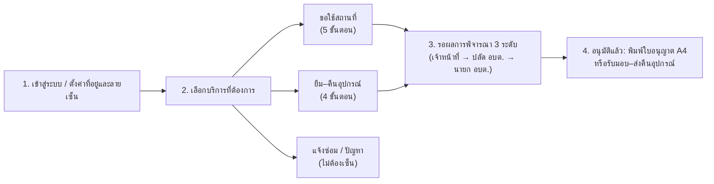
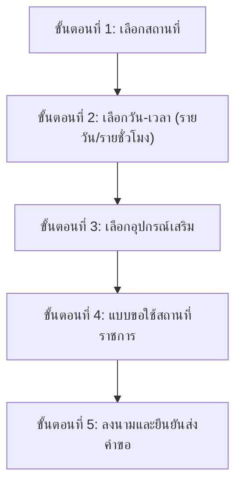
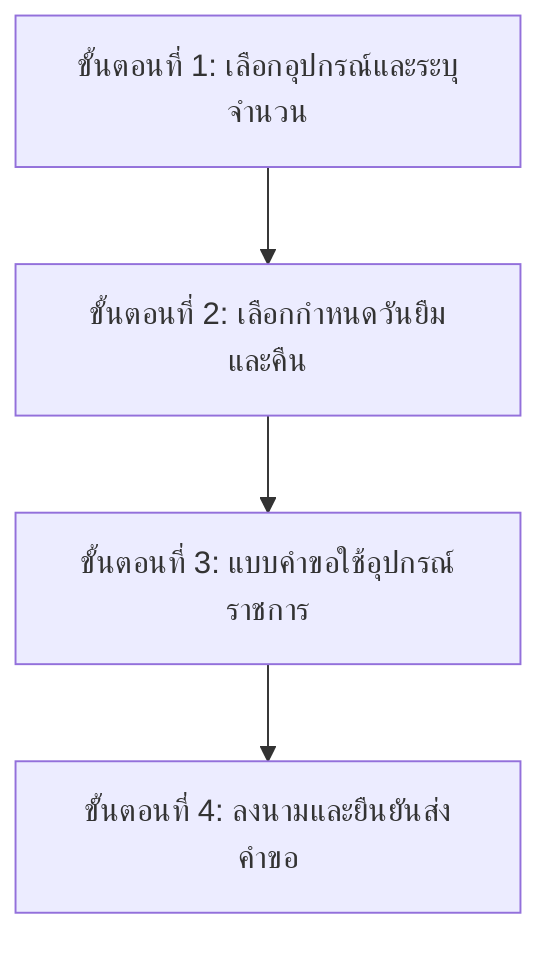

# คู่มือการใช้งานระบบสำหรับประชาชนและผู้ใช้งานทั่วไป (User Manual)
**ระบบจับจอง (JapJong) · บริการออนไลน์องค์การบริหารส่วนตำบล**  
*ขอใช้สถานที่ราชการ · ขอยืม–คืนอุปกรณ์ · แจ้งซ่อมและติดตามสถานะ*

---

## สารบัญ
1. [ภาพรวมขั้นตอนการใช้งาน](#1-ภาพรวมขั้นตอนการใช้งาน)
2. [การลงทะเบียนและเข้าสู่ระบบ](#2-การลงทะเบียนและเข้าสู่ระบบ)
3. [การตั้งค่าบัญชีส่วนตัว ที่อยู่ และลายมือชื่อประจำตัว](#3-การตั้งค่าบัญชีส่วนตัว-ที่อยู่-และลายมือชื่อประจำตัว)
4. [การขอใช้สถานที่ราชการ (5 ขั้นตอน)](#4-การขอใช้สถานที่ราชการ-5-ขั้นตอน)
5. [การขอยืม–คืนอุปกรณ์ราชการ (4 ขั้นตอน)](#5-การขอยืมคืนอุปกรณ์ราชการ-4-ขั้นตอน)
6. [การติดตามและแจ้งคืนใน "รายการยืมของฉัน" (ระบบแยกสิทธิ์ตามบัญชี)](#6-การติดตามและแจ้งคืนใน-รายการยืมของฉัน-ระบบแยกสิทธิ์ตามบัญชี)
7. [การแจ้งซ่อมบำรุงและตรวจรับงานซ่อม](#7-การแจ้งซ่อมบำรุงและตรวจรับงานซ่อม)
8. [การติดตามสถานะ ขอเลื่อนวันเวลา ยกเลิก และพิมพ์ใบอนุญาต (PDF/A4)](#8-การติดตามสถานะ-ขอเลื่อนวันเวลา-ยกเลิก-และพิมพ์ใบอนุญาต-pdfa4)
9. [การใช้งานผ่าน LINE Official Account & LINE Rich Menu (LIFF)](#9-การใช้งานผ่าน-line-official-account--line-rich-menu-liff)
10. [คำถามที่พบบ่อย (FAQ)](#10-คำถามที่พบบ่อย-faq)

---

## 1. ภาพรวมขั้นตอนการใช้งาน

> **จุดเด่นของระบบในการยื่นคำขอ:**
> - **แถบส่วนหัวและท้ายตรึงติดหน้าจอ (Sticky Header & Footer):** ขณะเลื่อนดูรายการสถานที่หรืออุปกรณ์ แถบแสดงขั้นตอนจะตรึงอยู่ด้านบน และแถบสรุปรายการพร้อมปุ่ม "ถัดไป" จะลอยตรึงอยู่ด้านล่างเสมอ ไม่ต้องเลื่อนจอย้อนไปมา
> - **ระบบเติมข้อมูลอัตโนมัติ (Profile Pre-filling):** ข้อมูลชื่อ ที่อยู่ตามทะเบียนราษฎร์ และลายเซ็นจะถูกดึงลงแบบฟอร์มราชการให้อัตโนมัติ
> - **บัญชีใครบัญชีมัน (Strict Account Isolation):** รายการยืมของฉันและประวัติคำขอจะแสดงเฉพาะรายการของเจ้าของบัญชีเท่านั้น ปลอดภัยและเป็นส่วนตัว

---

## 2. การลงทะเบียนและเข้าสู่ระบบ

### 2.1 การลงทะเบียนผู้ใช้งานใหม่ (`/register`)
สำหรับประชาชนที่เข้าใช้งานระบบเป็นครั้งแรก:
1. ไปที่หน้าเข้าสู่ระบบ แล้วกดปุ่ม **"ลงทะเบียน"**
2. กรอกข้อมูลส่วนตัว:
   - **ชื่อ–นามสกุล**
   - **เบอร์โทรศัพท์มือถือ** (ใช้เป็นชื่อผู้ใช้งานสำหรับเข้าสู่ระบบ)
   - **หน่วยงาน / ชุมชน / กลุ่ม** (เช่น *กลุ่มแม่บ้านบ้านหนองบัว* หรือ *ประชาชนทั่วไป*)
   - **รหัสผ่าน** (ความยาวอย่างน้อย 8 ตัวอักษร ผสมตัวอักษรและตัวเลข)
3. กด **"ขอรหัส OTP"** และกรอกรหัสยืนยัน 6 หลัก *(ในโหมดทดสอบระบบใช้รหัส `000000`)*
4. กดยืนยันการลงทะเบียน ระบบจะนำเข้าสู่หน้าแรกทันที

### 2.2 การเข้าสู่ระบบ (`/login`)
1. กรอก **ชื่อผู้ใช้ (Username)** หรือ **เบอร์โทรศัพท์** และ **รหัสผ่าน**
2. ตรวจสอบการทำเครื่องหมายที่ช่อง **"ยินยอมให้เก็บ ใช้ และเปิดเผยข้อมูลส่วนบุคคลตามนโยบาย PDPA"**
3. กดปุ่ม **"เข้าสู่ระบบ"**

---

## 3. การตั้งค่าบัญชีส่วนตัว ที่อยู่ และลายมือชื่อประจำตัว

> [!TIP]
> **แนะนำอย่างยิ่ง:** ให้ตั้งค่า **ที่อยู่** และ **ลายมือชื่อประจำตัว** ในหน้าบัญชีก่อนยื่นคำขอ เพื่อให้ระบบดึงข้อมูลไปกรอกในแบบคำขอราชการให้อัตโนมัติทุกครั้งโดยไม่ต้องพิมพ์ใหม่

กดที่เมนู **"จัดการบัญชีส่วนตัว"** ในแถบเมนูด้านซ้าย (หรือคลิกที่ชื่อของคุณบริเวณมุมซ้ายล่าง) จะพบ 3 แท็บหลัก:

### แท็บที่ 1: ข้อมูลโปรไฟล์ & หน่วยงาน
- แก้ไข **ชื่อ-นามสกุล**, **ชื่อเล่น**, **หน่วยงาน / ชุมชน / สังกัด**, และ **เบอร์โทรศัพท์**
- กรอก **ที่อยู่ (สำหรับแบบคำขอราชการ)** ได้แก่:
  - **อยู่บ้านเลขที่**
  - **หมู่ที่**
  - **ตำบล / แขวง**
  - **อำเภอ / เขต**
  - **จังหวัด**
- กดปุ่ม **"บันทึกการเปลี่ยนแปลง"** — ข้อมูลชุดนี้จะถูกดึงไปใส่ในแบบขอใช้สถานที่และแบบคำขอใช้อุปกรณ์ให้อัตโนมัติ

### แท็บที่ 2: เปลี่ยนรหัสผ่าน (Password)
- กรอก **รหัสผ่านปัจจุบัน**
- กรอก **รหัสผ่านใหม่** และ **ยืนยันรหัสผ่านใหม่**
- กดปุ่ม **"บันทึกรหัสผ่านใหม่"**

### แท็บที่ 3: ลายมือชื่อ & รหัส PIN
- ใช้เมาส์หรือนิ้วมือเขียน **ลายมือชื่อ** ลงในกรอบสีขาว แล้วกด **"บันทึกลายมือชื่อประจำตัว"**
- เมื่อบันทึกไว้แล้ว เวลาทำเรื่องขอใช้สถานที่หรือยืมอุปกรณ์ คุณจะสามารถกดปุ่ม **"ใช้ลายเซ็นที่บันทึกไว้"** เพื่อลงนามได้ทันทีในคลิกเดียว

---

## 4. การขอใช้สถานที่ราชการ (5 ขั้นตอน)

กดที่เมนู **"ขอใช้สถานที่"** (`/booking`) จากหน้าแรกหรือแถบเมนูด้านซ้าย:

### แถบควบคุมอัจฉริยะ (Pinned Controls):
- **แถบด้านบน (Sticky Step Header):** ตรึงอยู่ด้านบนสุด (`top-0`) พร้อมเอฟเฟกต์โปร่งแสง แสดงขั้นตอนปัจจุบัน (`ขั้นตอนที่ 1 จาก 5`) และสรุปจำนวนสถานที่ที่เลือกไว้ (`เลือกแล้ว X แห่ง`) ไม่เลื่อนหายไปขณะเลือกดูห้อง
- **แถบด้านล่าง (Pinned Action Footer):** ลอยตรึงอยู่ด้านล่างหน้าจอ (`bottom-0`) แสดงชิปสถานที่ที่เลือกไว้ (สามารถคลิก `✕` เพื่อนำออกได้) พร้อมปุ่ม **"ล้างทั้งหมด"** และปุ่ม **"ถัดไป · เลือกวัน-เวลา"** ทำให้กดไปต่อได้ทันทีโดยไม่ต้องเลื่อนหน้าจอลงล่างสุด

---

### ขั้นตอนที่ 1: เลือกสถานที่
- ค้นหาด้วยชื่อ หรือกรองตามหมวดหมู่สถานที่ (*ห้องประชุม, ศาลาอเนกประสงค์, สนามกีฬา, ลานกิจกรรม*)
- ตรวจสอบความจุและสิ่งอำนวยความสะดวก
- คลิกเลือกการ์ดสถานที่ที่ต้องการ (สามารถเลือกได้มากกว่า 1 แห่งในคำขอเดียวกัน เฉพาะที่สถานะเป็น **"พร้อมใช้งาน"**)
- ดูชิปสรุปที่แถบด้านล่าง แล้วกด **"ถัดไป · เลือกวัน-เวลา"**

### ขั้นตอนที่ 2: เลือกวัน-เวลา (รองรับรายวันและรายชั่วโมง)
- สลับโหมดการจองได้ตามต้องการ:
  - **โหมดรายชั่วโมง (Hourly):** เหมาะกับการประชุม อบรม สัมมนา สามารถระบุเวลาเริ่มต้นและเวลาสิ้นสุดได้ละเอียด
  - **โหมดเต็มวัน (Full Day):** เหมาะกับงานจัดนิทรรศการ เทศกาล หรือแข่งขันกีฬา
- แตะเลือกวันที่บนปฏิทิน (จุดสีเขียว = ว่างมาก, สีเหลือง = ว่างบางช่วง, สีแดง = เต็ม)
- หากต้องการขอใช้หลายช่วงวัน กดปุ่ม **"+ เพิ่มช่วงเวลา"**
- ระบบจะตรวจสอบการชนคิวแบบเรียลไทม์ เมื่อขึ้นสถานะ **"ว่าง"** ให้กด **"ถัดไป · เลือกอุปกรณ์เสริม"**

### ขั้นตอนที่ 3: เลือกอุปกรณ์เสริม
- หากต้องการใช้อุปกรณ์ประจำสถานที่ (เช่น *โปรเจกเตอร์, ไมโครโฟนไร้สาย, เครื่องเสียง, โต๊ะ-เก้าอี้*) กดปุ่ม **`+`** / **`-`** เพื่อระบุจำนวน
- ระบบจะคำนวณจำนวนคงเหลือให้อัตโนมัติ
- หากไม่ต้องการอุปกรณ์เสริม สามารถกดปุ่ม **"ถัดไป · แบบขอใช้สถานที่"** เพื่อข้ามขั้นตอนนี้ได้ทันที

### ขั้นตอนที่ 4: แบบขอใช้สถานที่ราชการ
- ข้อมูลผู้ยื่นคำขอ: ระบบจะดึง **ชื่อ-นามสกุล**, **ที่อยู่ตามทะเบียนราษฎร์**, และ **หน่วยงาน** มาลงฟอร์มให้อัตโนมัติ
- กรอกข้อมูลเพิ่มเติม:
  - **เขียนที่** (เช่น *ที่ทำการ อบต.* หรือ *บ้านเลขที่ของผู้ขอ*)
  - **ตำแหน่ง** (เช่น *ประธานกลุ่ม*, *ผู้แทนชุมชน*, หรือ *ประชาชน*)
  - **จำนวนผู้เข้าร่วม (คน)**
  - **วัตถุประสงค์ในการขอใช้**
- ในส่วน **"มีความประสงค์ขอใช้สถานที่ราชการ ดังนี้"**: ตารางสถานที่และอุปกรณ์เสริมจะถูกล็อกไว้ตรงตามที่เลือกไว้ในขั้นตอนที่ 1 และ 3 เพื่อป้องกันความคลาดเคลื่อน *(หากต้องการแก้ไข ให้กดย้อนกลับไปเปลี่ยนในขั้นตอนก่อนหน้า)*
- แนบเอกสารประกอบ (ถ้ามี เช่น กำหนดการประชุม หรือหนังสือขอความอนุเคราะห์)
- กดปุ่ม **"ถัดไป · ลงนามและส่ง"**

### ขั้นตอนที่ 5: ลงนามและยืนยันส่งคำขอ
- ตรวจสอบความถูกต้องของแบบคำขอราชการฉบับเต็มบนหน้าจอ
- ลงลายมือชื่อดิจิทัล:
  - วาดลายเซ็นสดลงในกรอบ Canvas สีขาว
  - หรือกดปุ่ม **"ใช้ลายเซ็นที่บันทึกไว้"** เพื่อดึงลายเซ็นจากโปรไฟล์มาใส่ทันที
- ตรวจสอบความถูกต้อง แล้วกดปุ่ม **"ยืนยันส่งคำขอ"**

---

## 5. การขอยืม–คืนอุปกรณ์ราชการ (4 ขั้นตอน)

สำหรับการขอยืมอุปกรณ์ของ อบต. ไปใช้งานนอกสถานที่ (โดยไม่ได้จองสถานที่ของ อบต.) ให้เข้าที่เมนู **"ยืม–คืนอุปกรณ์"** (`/borrow`):

### แถบควบคุมอัจฉริยะ (Pinned Controls):
- มี **Sticky Step Header** ตรึงด้านบน แจ้งขั้นตอน (`ขั้นตอนที่ 1 จาก 4`)
- มี **Pinned Action Footer** ตรึงด้านล่าง แสดงสรุปจำนวนรายการและยอดชิ้นอุปกรณ์ที่เลือกไว้ พร้อมปุ่มกดยกเลิกและปุ่มไปขั้นตอนถัดไป

---

### ขั้นตอนที่ 1: เลือกอุปกรณ์และระบุจำนวน
- ค้นหาอุปกรณ์ตามชื่อหรือหมวดหมู่ (*เครื่องเสียงและโสตทัศนูปกรณ์, เต็นท์/โต๊ะ/เก้าอี้, คอมพิวเตอร์/IT*)
- กดปุ่ม **`+`** / **`-`** บนการ์ดอุปกรณ์เพื่อระบุจำนวนชิ้นที่ต้องการยืม (ระบบจะจำกัดไม่ให้เกินจำนวนคงเหลือในคลังพัสดุ)
- สามารถเลือกอุปกรณ์หลายประเภทพร้อมกันในคำขอเดียวได้
- ดูสรุปยอดรวมที่แถบล่าง แล้วกดปุ่ม **"ถัดไป · เลือกวันยืม-คืน"**

### ขั้นตอนที่ 2: เลือกกำหนดวันยืมและคืนอุปกรณ์
- เลือก **วันที่เริ่มยืม (วันรับอุปกรณ์)**
- เลือก **วันที่สิ้นสุด (กำหนดส่งคืนอุปกรณ์)**
- ระบบจะคำนวณจำนวนวันยืมให้อัตโนมัติ พร้อมตรวจเช็คสต็อกอุปกรณ์ในช่วงวันที่ระบุ
- ตรวจสอบความถูกต้อง แล้วกดปุ่ม **"ถัดไป · กรอกคำขอ"**

### ขั้นตอนที่ 3: แบบคำขอใช้อุปกรณ์ราชการ
- ตรวจสอบข้อมูลส่วนตัว ที่อยู่ และเบอร์โทรศัพท์ที่ระบบเติมให้อัตโนมัติ
- กรอก **เขียนที่**, **ตำแหน่ง**, และ **วัตถุประสงค์ในการนำอุปกรณ์ไปใช้งาน**
- ตรวจสอบตารางรายการอุปกรณ์และจำนวนที่ระบุไว้ในขั้นตอนที่ 1
- แนบเอกสารเพิ่มเติม (ถ้ามี) แล้วกดปุ่ม **"ถัดไป · ลงนามและส่ง"**

### ขั้นตอนที่ 4: ลงนามและยืนยันส่งคำขอ
- ตรวจทานแบบคำขอใช้อุปกรณ์ราชการ
- ลงลายมือชื่อดิจิทัลในกรอบลงนาม (วาดสด หรือคลิก **"ใช้ลายเซ็นที่บันทึกไว้"**)
- กดปุ่ม **"ส่งคำขอ"** เพื่อส่งเรื่องเข้าสู่ระบบพิจารณาของเจ้าหน้าที่

---

## 6. การติดตามและแจ้งคืนใน "รายการยืมของฉัน" (ระบบแยกสิทธิ์ตามบัญชี)

เข้าสู่หน้า **"รายการยืม"** (`/borrow/my`) จากแถบเมนูด้านซ้าย:

### ระบบแยกสิทธิ์เด็ดขาด (Account Isolation - บัญชีใครบัญชีมัน):
- หน้า "รายการยืมของฉัน" จะแสดง **เฉพาะคำขอที่ผูกกับบัญชีผู้ใช้งานที่กำลังล็อกอินอยู่เท่านั้น**
- รายการยืมของประชาชนท่านอื่น หรือคำขอที่เจ้าหน้าที่บันทึกให้ผู้อื่น จะไม่แสดงปะปนในหน้านี้อย่างเด็ดขาด

### การใช้งานแบ่งเป็น 3 แท็บสถานะ:
1. **แท็บ "ที่กำลังใช้งาน":**
   - แสดงรายการอุปกรณ์ที่ท่านกำลังยืมอยู่ หรือคำขอที่ได้รับอนุมัติแล้วและอยู่ระหว่างรอรับมอบ
   - แสดงวันที่เริ่มยืม, กำหนดวันส่งคืน, จำนวนวันคงเหลือ, และสถานะการตรวจสภาพ
   - เมื่อนำอุปกรณ์มาส่งคืนที่ อบต. เรียบร้อย ให้กดปุ่ม **"แจ้งคืนอุปกรณ์"**
2. **แท็บ "รอตรวจสอบ":**
   - แสดงรายการที่ท่านกดแจ้งคืนแล้ว อยู่ระหว่างรอเจ้าหน้าที่พัสดุตรวจนับจำนวน ตรวจสภาพการใช้งาน และลงนามรับคืน
3. **แท็บ "ประวัติ":**
   - แสดงประวัติการยืม-คืนอุปกรณ์ทั้งหมดที่เสร็จสิ้นสมบูรณ์แล้วในอดีต

### รูปแบบหน้าจอสองฝั่ง (Split-Pane Interface):
- **ฝั่งซ้าย:** รายการการ์ดคำขอยืม พร้อมช่องค้นหาด่วนตามชื่ออุปกรณ์หรือเลขที่คำขอ
- **ฝั่งขวา:** แผงแสดงรายละเอียดฉบับเต็มของคำขอที่เลือก แสดงชื่อผู้ยืม, กำหนดเวลา, รายการอุปกรณ์, หลักฐานรูปภาพตรวจสภาพก่อน-หลังใช้งาน และบันทึกข้อความจากเจ้าหน้าที่

---

## 7. การแจ้งซ่อมบำรุงและตรวจรับงานซ่อม

หากพบเห็นสถานที่ ชำรุด เสียหาย หรืออุปกรณ์ใช้งานไม่ได้ สามารถแจ้งเรื่องได้ทันทีที่เมนู **"แจ้งซ่อม / ปัญหา"** (`/repair`):
> **หมายเหตุ:** การแจ้งซ่อมบำรุง **ไม่ต้องลงลายมือชื่อดิจิทัล** เพื่อให้ประชาชนสามารถส่งเรื่องร้องเรียนได้อย่างรวดเร็ว

### ขั้นตอนการแจ้งเรื่อง:
1. เลือก **อาคาร**, **ชั้น**, และระบุ **จุดที่พบปัญหา** (เช่น *อาคารอเนกประสงค์ · เครื่องปรับอากาศทิศเหนือ*)
2. เลือก **หมวดหมู่งานซ่อม** (*ไฟฟ้า/แสงสว่าง, ประปา/สุขาภิบาล, เครื่องปรับอากาศ, โสตทัศนูปกรณ์, โครงสร้างอาคาร*)
3. อธิบาย **รายละเอียดอาการชำรุด** ให้ชัดเจน
4. แนบรูปถ่ายจุดที่ชำรุด (สามารถถ่ายภาพจากกล้องมือถือหรืออัปโหลดรูปภาพได้)
5. กดปุ่ม **"ส่งเรื่องแจ้งซ่อม"**

### การตรวจรับงานซ่อม:
- เมื่อช่างของ อบต. เข้าไปดำเนินการซ่อมแซมเสร็จสิ้น สถานะจะเปลี่ยนเป็น **"รอยืนยันรับงาน"**
- ท่านสามารถเปิดดูภาพถ่ายหลังการซ่อมแซม และกดปุ่ม **"ยืนยันตรวจรับงานซ่อม"** เพื่อเสร็จสิ้นกระบวนการ

---

## 8. การติดตามสถานะ ขอเลื่อนวันเวลา ยกเลิก และพิมพ์ใบอนุญาต (PDF/A4)

ติดตามคำขอทั้งหมดได้จากเมนู **"ประวัติคำขอทั้งหมด"** (`/history`) หรือดูสรุปบนแดชบอร์ด **"หน้าแรกบริการ"** (`/`):

### ความหมายของสถานะคำขอ
| สถานะ | ความหมาย | สิ่งที่ต้องทำต่อไป |
| :--- | :--- | :--- |
| **รอเจ้าหน้าที่ตรวจ** | คำขอถูกส่งแล้ว อยู่ระหว่างเจ้าหน้าที่ธุรการตรวจเอกสาร | รอผลการตรวจสอบ |
| **รอปลัด อบต. พิจารณา** | ผ่านเจ้าหน้าที่แล้ว อยู่ระหว่างปลัด อบต. ลงนามความเห็น | รอผลการพิจารณา |
| **รอนายก อบต. อนุมัติ** | ปลัด อบต. เห็นชอบแล้ว อยู่ระหว่างนายก อบต. ลงนามอนุมัติ | รอผลคำสั่งอนุมัติ |
| **อนุมัติแล้ว** | ได้รับการอนุมัติครบทั้ง 4 ฝ่ายเรียบร้อยแล้ว | พิมพ์ใบอนุญาต / เตรียมรับมอบ |
| **กำลังยืม** | ได้รับมอบอุปกรณ์เรียบร้อยแล้ว | ส่งคืนตามกำหนด |
| **ส่งคืนแล้ว** | เจ้าหน้าที่ตรวจรับคืนอุปกรณ์เรียบร้อย สมบูรณ์ | สิ้นสุดกระบวนการ |
| **ไม่อนุมัติ** | คำขอไม่ผ่านการพิจารณา | ดูเหตุผลในรายละเอียดคำขอ |

---

### การดำเนินการในหน้ารายละเอียดคำขอ (`/requests/[id]`):
- **พิมพ์เอกสารราชการฉบับทางการ (Official A4 / PDF):**
  - กดปุ่ม **"พิมพ์เอกสาร / บันทึก PDF"**
  - ระบบจะจัดหน้ากระดาษแบบฟอร์มทางการ A4 พอดีหน้า บังคับโหมดสีมาตรฐาน (Light Mode) ป้องกันปัญหาหมึกพิมพ์สิ้นเปลือง และซ่อน URL หัวกระดาษของเว็บเบราว์เซอร์อัตโนมัติ
- **การตรวจสอบความถูกต้องด้วย QR Code (Document Verification):**
  - เอกสารที่อนุมัติแล้วจะมี **QR Code ประจำเอกสาร** อยู่ที่มุมล่างขวา
  - บุคคลภายนอกหรือเจ้าหน้าที่สามารถใช้กล้องโทรศัพท์มือถือสแกน QR Code เพื่อเปิดหน้าตรวจสอบสถานะเอกสารจริง (`/verify/[token]`) ได้ทันทีโดยไม่ต้องติดตั้งแอปพลิเคชันเพิ่มเติม
- **ขอเลื่อนวัน–เวลา (สำหรับคำขอจองสถานที่):**
  - หากติดภารกิจ สามารถกดปุ่ม **"ขอเลื่อนวัน-เวลา"** เพื่อเลือกช่วงวันเวลาใหม่ได้ (ระบบจะตรวจสอบคิวว่างและส่งเรื่องให้พิจารณา)
- **ยกเลิกคำขอ:**
  - หากไม่ต้องการใช้งานแล้ว สามารถกดยกเลิกคำขอได้ด้วยตนเองก่อนที่คำขอจะถูกนำไปใช้งาน

---

## 9. การใช้งานผ่าน LINE Official Account & LINE Rich Menu (LIFF)

ระบบจับจอง (JapJong) เชื่อมต่อกับ **LINE Official Account** ช่วยให้ประชาชนยื่นคำขอและรับการแจ้งเตือนได้โดยตรงจากแอป LINE บนมือถือ

### 9.1 การเริ่มใช้งานและ LINE LIFF Single Sign-On
1. เพิ่มเพื่อนกับ LINE Official Account ของ อบต.
2. แตะปุ่มบริการบนแถบเมนูด้านล่างห้องแชท (LINE Rich Menu)
3. ระบบจะเปิดหน้าต่างบริการผ่านเทคโนโลยี **LIFF (LINE Front-end Framework)** และเข้าสู่ระบบให้อัตโนมัติโดยไม่ต้องจำรหัสผ่าน
4. **สำหรับการใช้งานครั้งแรก:** กรอกเบอร์โทรศัพท์ ตรวจสอบชื่อ และติ๊กยินยอมตามนโยบาย PDPA จากนั้นจะใช้งานได้ทันที

---

### 9.2 เมนูบริการสำหรับประชาชน (Citizen Rich Menu - 6 ช่อง)

| แถว / ปุ่ม | ชื่อปุ่ม | การทำงาน |
| :--- | :--- | :--- |
| **แถวบน ซ้าย** | **จองสถานที่** | เปิดหน้าขอใช้สถานที่ (5 ขั้นตอน) พร้อมแถบตรึงบน-ล่าง |
| **แถวบน กลาง** | **ยืมอุปกรณ์** | เปิดหน้ายืมอุปกรณ์ (4 ขั้นตอน) พร้อมเช็คสต็อกคงเหลือ |
| **แถวบน ขวา** | **แจ้งปัญหา** | แจ้งเรื่องซ่อมแซมและจุดชำรุดด่วน |
| **แถวล่าง ซ้าย** | **รายการยืมของฉัน** | ดูอุปกรณ์ที่กำลังยืม วันกำหนดคืน และปุ่มแจ้งคืน |
| **แถวล่าง กลาง** | **ประวัติคำขอทั้งหมด** | ดูสถานะคำขอทั้งหมด พิมพ์เอกสาร และขอเลื่อนวันเวลา |
| **แถวล่าง ขวา** | **ติดต่อเจ้าหน้าที่** | ส่งข้อความอัตโนมัติเพื่อสนทนากับเจ้าหน้าที่ อบต. |

---

### 9.3 การรับข้อความแจ้งเตือนผ่าน LINE (Flex Messages)
เมื่อสถานะคำขอของท่านมีการเปลี่ยนแปลง ระบบจะส่งการ์ดแจ้งเตือน (Flex Message) เข้ามาในแชท LINE อัตโนมัติ เช่น:
- เมื่อเจ้าหน้าที่หรือผู้บริหารลงนามอนุมัติคำขอ
- ข้อความแจ้งเตือนล่วงหน้า 1 วันก่อนถึงกำหนดใช้งานสถานที่
- ข้อความแจ้งเตือนกำหนดส่งคืนอุปกรณ์
- ข้อความแจ้งความคืบหน้าการซ่อมบำรุง
- สามารถแตะปุ่ม **"ดูรายละเอียดคำขอ"** ในการ์ด LINE เพื่อเปิดดูเอกสารหรือหลักฐานได้ทันที

---

## 10. คำถามที่พบบ่อย (FAQ)

**Q: ทำไมในขั้นตอนที่ 4 ของการจองสถานที่ จึงแก้ไขชื่อสถานที่หรือจำนวนอุปกรณ์ในตารางไม่ได้?**  
**A:** เพื่อความถูกต้องตรงตามระบบคิวว่างและสต็อกพัสดุที่ตรวจสอบแล้ว ระบบจึงล็อกตารางรายการไว้ให้ตรงกับขั้นตอนที่ 1 และ 3 หากต้องการเปลี่ยนแปลง สามารถกดย้อนกลับไปแก้ไขในขั้นตอนที่ 1 หรือ 3 ได้โดยข้อมูลที่กรอกไว้จะไม่สูญหาย

**Q: การยืมอุปกรณ์มีกี่ขั้นตอน แตกต่างจากการจองสถานที่อย่างไร?**  
**A:** การยืมอุปกรณ์มี **4 ขั้นตอน** (เลือกอุปกรณ์ → กำหนดวันยืมและคืน → กรอกแบบคำขอ → ลงนาม) โดยแยกขั้นตอนการเลือกวันยืม-คืนออกมาเป็นขั้นตอนที่ 2 ชัดเจน เพื่อให้ระบบตรวจสอบสต็อกคงเหลือของอุปกรณ์ชิ้นนั้นๆ ในช่วงวันที่ต้องการได้อย่างแม่นยำ

**Q: ทำไมเพื่อนยืมอุปกรณ์เหมือนกัน แต่ใน "รายการยืมของฉัน" มองไม่เห็นของเพื่อน?**  
**A:** ระบบใช้มาตรฐานความปลอดภัย **"บัญชีใครบัญชีมัน (Strict Account Isolation)"** โดยหน้ารายการยืมจะกรองแสดงเฉพาะรายการที่เจ้าของบัญชีนั้นๆ เป็นผู้ยื่นขอเท่านั้น เพื่อความเป็นส่วนตัวและความถูกต้องของความรับผิดชอบในทรัพย์สินราชการ

**Q: แถบขั้นตอนด้านบนและปุ่มด้านล่างเลื่อนตามหน้าจอได้อย่างไร?**  
**A:** ระบบออกแบบหน้าจอแบบ **Pinned Sticky Layout** โดยแถบแสดงขั้นตอนจะตรึงอยู่ด้านบนสุด (`top-0`) และแถบสรุปรายการพร้อมปุ่มถัดไปจะลอยตรึงอยู่ด้านล่างสุด (`bottom-0`) เสมอ ช่วยให้ผู้ใช้งานบนโทรศัพท์มือถือและแท็บเล็ตไม่ต้องเลื่อนจอยาวเพื่อค้นหาปุ่มถัดไป

**Q: คำขอต้องผ่านการลงนามกี่ระดับจึงจะมีผลสมบูรณ์?**  
**A:** เอกสารราชการขอใช้สถานที่และขอยืมอุปกรณ์ต้องผ่านการลงนามดิจิทัลครบ **4 ฝ่าย**:  
1. ผู้ขออนุญาต (ประชาชน/ผู้ยื่นคำขอ)  
2. เจ้าหน้าที่ผู้ตรวจสอบ  
3. ปลัดองค์การบริหารส่วนตำบล (ผู้เห็นชอบ)  
4. นายกองค์การบริหารส่วนตำบล (ผู้อนุมัติ)  
เมื่อครบ 4 ฝ่ายแล้ว เอกสารจะได้รับการประทับตราดิจิทัลและ QR Code สำหรับตรวจสอบความถูกต้อง
